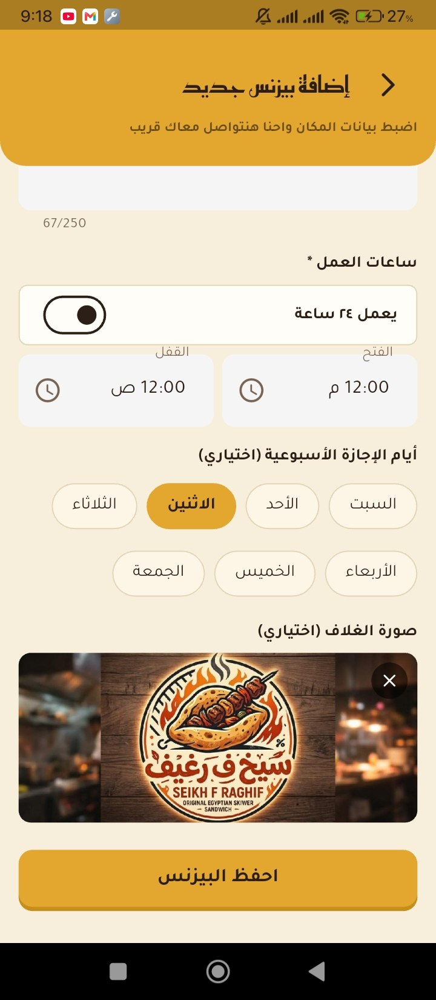

# La2eeha (لاقيها) — Local Business Directory App

A Flutter + Supabase mobile app that helps residents of **Shebin El-Kanater** and nearby villages (Qalyubia, Egypt) find local businesses — restaurants, clinics, pharmacies, shops, and sports facilities — replacing the current habit of asking in Facebook groups and waiting for replies.

Built solo, end-to-end: database design, Row Level Security, Clean Architecture, and a full merchant/end-user product flow.

---

## 📸 Screenshots

| Home                                         | Category List                                         | Business Detail                                         |
| -------------------------------------------- | ----------------------------------------------------- | ------------------------------------------------------- |
|  |  |  |

| Search                                         | Favorites                                         | Login                                         |
| ---------------------------------------------- | ------------------------------------------------- | --------------------------------------------- |
|  |  |  |

| Dark Mode                                         |
| ------------------------------------------------- |
|  |


### Email Verification (OTP)

| In-App OTP Screen                                        | Confirmation Email                                         |
| -------------------------------------------------------- | ---------------------------------------------------------- |
|  |  |

Pairs the in-app 6-digit code screen with the actual branded confirmation email (sent via Supabase Auth + a custom Brevo SMTP setup), showing the auth flow end-to-end rather than just the UI.

### Add Business Form

| Step 1                                                 | Step 2                                                 | Step 3                                                 |
| ------------------------------------------------------ | ------------------------------------------------------ | ------------------------------------------------------ |
|  |  |  |


---

## ✨ Key Technical Highlights

- **Clean Architecture + Cubit** — `data` / `domain` / `presentation` layers per feature, not a flat/demo structure
- **Supabase backend** — Postgres schema, Auth (Email/Password OTP + Google Sign-In), and **Row Level Security policies** enforcing per-role access (public read for approved listings, owner-only write access, admin-only tables)
- **Debugged a real RLS infinite-recursion bug** caused by a self-referencing policy — fixed by removing the redundant policy after confirming it was dead code
- **Real-time debounced search** across name, address, and area — with a client-side caching strategy specifically designed to minimize Supabase request volume on a free-tier budget
- **Local, account-free Favorites** — `shared_preferences`-backed, with a **Cubit-listening-to-Cubit** pattern for instant cross-screen sync without re-fetching
- **Paginated infinite-scroll lists** via `CustomScrollView`/slivers, replacing an earlier nested-`shrinkWrap` implementation for real lazy-loading performance
- **Form draft auto-save/restore** — merchant registration form survives a full app kill via debounced local persistence
- **Dark mode** with a full `ColorScheme`-based theme system
- **Open-source contribution** — found and fixed 3 real bugs (a cold-launch crash, a state-sync bug, and a rendering/clipping bug) in a third-party Flutter package, and got the fix **merged upstream via a Pull Request**

---

## 🏗 Architecture

```
lib/
├── core/            → network layer, error handling, local storage, theming, extensions, shared widgets
├── features/
│   ├── browse/       → end-user browsing (Home, Category List, Search, Business Detail)
│   ├── favorites/     → local favorites (global Cubit + cross-tab sync)
│   ├── auth/          → email/password + Google Sign-In, OTP verification
│   ├── merchant/       → business registration, form draft persistence
│   └── more/            → settings / account
└── main.dart
```

Each feature follows: `domain` (pure business rules, no Supabase imports) → `data` (Supabase calls + models) → `presentation` (Cubit + views).

---

## 🛠 Tech Stack

**Frontend:** Flutter, Dart, `flutter_bloc` (Cubit), `go_router`, `flutter_screenutil`, `flutter_animate`

**Backend:** Supabase (Postgres, Auth, Storage, Row Level Security) via `supabase_flutter`

**Other:** `shared_preferences`, `image_picker`, `pinput`, `connectivity_plus`, `logger`

---

## 🚧 Status

Actively developed. End-user side (browsing, search, favorites, business details) is fully complete. Merchant-side features (registration, authentication) are built; remaining merchant tools (menu management, business dashboard) are in progress.

---

## 📄 License

Private/personal project — not currently licensed for reuse.
